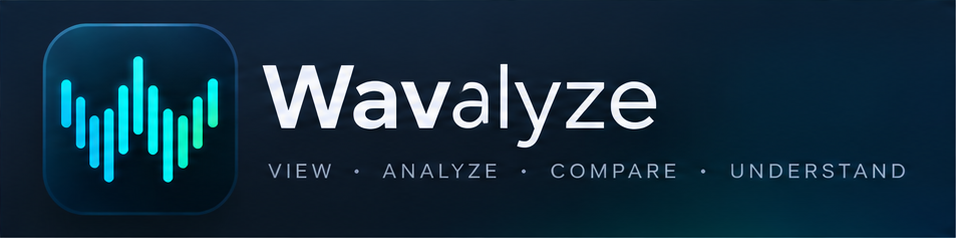
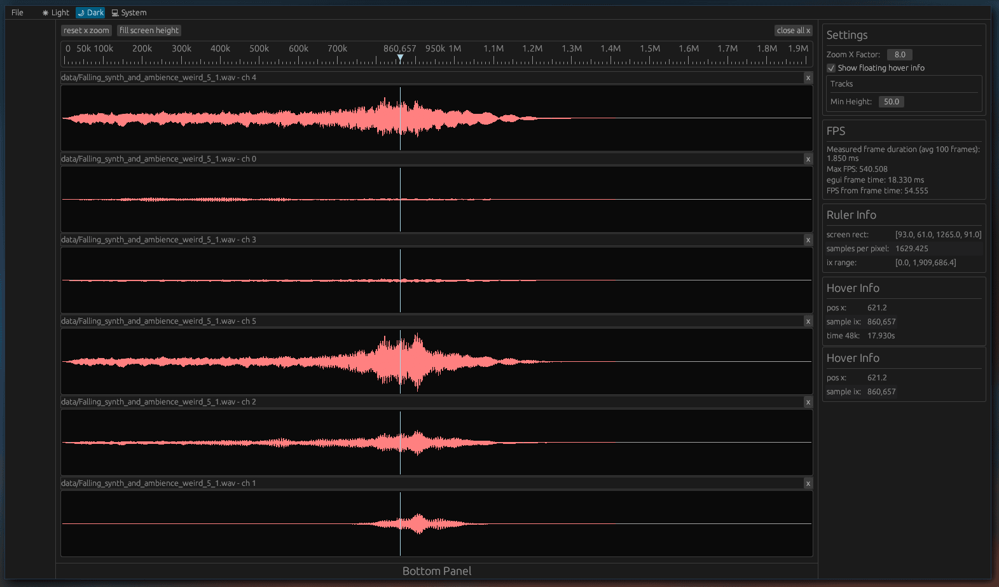

# Wavalyze

[](https://github.com/frydac/wavalyze/actions/workflows/rust.yml)
[](https://github.com/frydac/wavalyze/actions/workflows/cloudflare-pages.yml)



**Wavalyze** is a WAV file viewer with the goal of becoming an analysis and diff tool useful for (my personal) audio software development.

I started this project to learn about Rust and WebAssembly, and to have a tool that is faster to do
what I want to do than the freely available alternatives.




## WASM Web application

A WebAssembly build of the Wavalyze application hosted on cloudflare:  
[wavalyze.emile-vrijdags-github.workers.dev](https://wavalyze.emile-vrijdags-github.workers.dev/)

It loads a few tracks with generated waveform/metadata to quickly get a feel for the app.   
Configuration persistence and filesystem change notifications are native-only.
You can add `.wav` files by drag-and-drop or by using the File open dialog.  
I don't use this version, so some keymaps and mouse interactions might not work as expected.


## Docs

- [Mouse navigation](doc/mouse_navigation.md)
- [CLI arguments](doc/cli_args.md)
- [Channel orders and active layouts](doc/channel_orders.md)
- [Cloudflare deploy notes](doc/cloudflare_deploy.md)
- [Cargo and desktop distribution plan](doc/dev/distribution-plan.md)

## Features

- Multi-file waveform viewing
- Fast startup for quick file inspection
- Zoom and pan over x and y axes with multiple types of controls
   - see [Mouse navigation](doc/mouse_navigation.md)
- Sample-level hover details
  * Configure zoom level for when to show sample-level details
- Calculate track statistics (dB-RMS, peak) over a selection
  - Visual indication of peak value in selection
- Diff files/tracks, with offset adjustment
- Drag file headers or new WAVs onto an open file in Files to choose diff channel pairs
- WAVEX and Auro ID channel roles, with per-file order and active-layout selection
- Native file-change notifications with individual or batch reload and automatic diff recomputation
- Show/hide tracks with auto adjusting track height for filling the screen
- Native and browser builds
* Block-based visual indication and selection
  * Show selection and hover info in terms of block index and offset
  * Snap sample selection to block boundaries
  * Show grid lines for block boundaries
  * Configure block size and start offset

Non-goals:

- Audio playback (simple stereo playback likely at some point)
- Audio editing (probably never)

## Installation

### macOS

Build and install `Wavalyze.app` for the current user:

```bash
./scripts/install-macos.sh
```

The app is installed in `~/Applications`. The installer also creates the `wv` command in `~/.cargo/bin`.

To update an existing installation:

```bash
git pull
./scripts/install-macos.sh
```

Launch the app from Finder or the command line:

```bash
open "$HOME/Applications/Wavalyze.app"
wv --help
wv recording.wav
```

### Other platforms

No packaged installers are available. Build or run Wavalyze from source with Cargo:

```bash
cargo build --release
cargo run --release
```

## Local development

Native:

```bash
cargo run --release
```

Web (WASM):
```
rustup toolchain install nightly-2026-01-15 --target wasm32-unknown-unknown --component rust-src
cargo install --locked trunk
./scripts/trunk-threaded.sh serve
```

Open `http://127.0.0.1:8080/index.html#dev` to bypass the service worker cache during development.

### Browser settings

Configuration persistence is currently native-only. In the browser, setting changes apply to the current app session but are not saved and reset when the page is reloaded.

## CI

The main workflows are:

- [`rust.yml`](.github/workflows/rust.yml): native checks, tests, linting, cross-target builds, and threaded wasm validation
- [`cloudflare-pages.yml`](.github/workflows/cloudflare-pages.yml): production web build and deploy to Cloudflare Workers static assets

For a local CI-like run, use:

```bash
./check.sh
```

## Repository layout

- `src/`: Rust application, UI, model, audio, WAV loading, and WASM entrypoints
- `tests/`: integration tests grouped by subsystem
- `assets/`: icons, manifest, service worker, and other files copied into the web build
- `web/`: web hosting support files, including `_headers` for Cloudflare/COOP/COEP headers
- `scripts/`: project helper scripts, including the Trunk wrapper used for threaded WASM builds
- `doc/`: project notes, diagrams, screenshots, and generated CLI documentation
- `dev/nix/`: optional Nix development shell definition
- `.github/`: CI and deployment workflows
- `.cargo/`: Cargo configuration

Important root files:

- `Cargo.toml` / `Cargo.lock`: Rust package manifest and locked dependency graph
- `index.html` / `Trunk.toml`: Trunk web build entrypoint and configuration
- `wrangler.jsonc`: Cloudflare Workers static-assets deploy configuration
- `rust-toolchain` / `rustfmt.toml`: pinned Rust toolchain and formatting settings
- `check.sh`: local CI-like check script
- `.typos.toml`: spell-check configuration

Generated or local-only paths such as `target/`, `dist/`, `data/` (except the channel
definition snapshots), `perf.data*`, and `tags` are ignored by Git.

Optional Nix shell:

```bash
nix develop ./dev/nix
```

## Generating test audio

```sh
rake create_test_data      # Basic SoX fixtures plus WAVEX fixtures
rake test_data:basic       # Basic fixtures only (requires SoX)
rake test_data:wavex       # WAVEX fixtures only (Ruby, no SoX required)
```

The generation code lives in `scripts/generate_test_data.rb`. Basic fixtures keep
their existing filenames in `data/`. WAVEX fixtures go into `data/wavex/` and cover
stereo, quad, 5.1, Auro 9.1, Auro 13.1, 22.0, and 22.2. Open these WAVs
in wavalyze to inspect channel titles and layout metadata.

Each WAVEX file contains one second of 48 kHz, 16-bit PCM with an explicit
WAVEFORMATEXTENSIBLE channel mask and PDF-convention interleaving. Every channel
has a distinct sine frequency (`440 + 200 * channel_index` Hz). The generated
`manifest.json` lists the layouts, masks, channel IDs in order, and frequencies.
22.2 uses mask `0xFFFFFF`; 22.0 uses `0xFBFFF7`. Channel order follows
[Auro-3D in multi-channel WAV, Revision 2 (2024-04-19)](https://www.auro-3d.com/wp-content/uploads/2024/04/Auro-3D-in-multi-channel-WAV-White-Paper-20240419.pdf),
pages 1–2; 22.0 is derived by removing both LFE channels. The six extension bits
are Auro assignments, distinct from FFmpeg's numeric mask convention.

The 22.x files are now named `wavex_22_0.wav` and `wavex_22_2.wav`; layout metadata
retains the catalog names `NHK_22.0` and `NHK_22.2`. Regeneration replaces the files
listed in the manifest and leaves other files in the output directory untouched.
Older `wavex_nhk_22_*` fixtures follow the provisional March 17 memo and are stale.
See [channel mapping details](data/channel/README.md) for decoding context and
ambiguous-mask behavior.

Generated WAVs and their manifest remain ignored by Git; the scripts are committed.
For another output location, run
`ruby scripts/generate_test_data.rb --kind wavex --output-dir /tmp/wavalyze-audio`.
Run the header, order, signal, and determinism checks with
`ruby scripts/test_generate_test_data.rb`.

## Reloading changed files

On desktop, file changes for opened WAV files are detected and shown above the Files list.
Choose **Update** for one file or **Update all** for all changed files. Hover over a changed
filename to see its full path, affected tracks and diffs, and the offsets that will be reused.

Reload preserves track layout, visibility, selection, and existing file/track/diff alignment
offsets. Automatic alignment is not rerun. Individual updates use the other diff inputs as
currently loaded, even if those files also have pending changes. Added channels are shown in
metadata but are not automatically loaded; the original channel selection and sample range
are preserved.

Each update is all-or-nothing: new audio and associated diffs replace the old data together.
If a file is missing, incomplete, loses a loaded channel, or produces incompatible diff sample
rates, the previous data remains available and the notification shows an error. Retry after
regenerating the file, or update an unaffected file individually. Files that change during an
update remain pending for retry.

For each file we watch, we also watch its ancestor directories.
When when a filetree containing a loaded file is removed and regenerated, then the monitoring is
restored for the new tree.
There is no polling fallback for filesystems that do not deliver notifications. Browser uploads
are byte snapshots, so the browser build does not show these controls.

